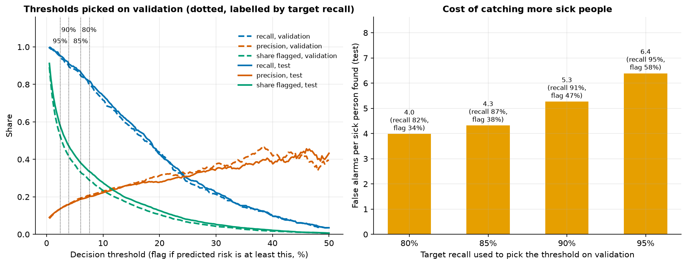

# NHANES Heart Risk: predicting self-reported heart disease from CDC survey data

An end-to-end data pipeline and modeling project: it downloads public CDC health survey files, cleans them in PostgreSQL, trains three models, tests them on a later survey period, and shows the result in a small web app. Educational only, not medical advice.

**Live demo:** https://heartrisk-prediction-system.streamlit.app/ (the app may take a few seconds to wake up if nobody has used it for a while)



## What is this?

Every two years the CDC runs a health survey called **NHANES**: people answer questions, get measured
and give a blood sample. One question asks whether a doctor ever told them they had coronary heart
disease, angina or a heart attack. This project asks how well age, sex, body measurements, blood
pressure, blood tests, smoking, diabetes and alcohol answers can tell who said yes.

It covers the whole path: download and checksum the CDC files, load them into PostgreSQL, clean and
join them with SQL, run 42 automated data quality checks, train a logistic regression, a random forest
and XGBoost, and test them on a *later* survey period than the one they learned from. The numbers below
are written by code, not typed.

## Key results

Data: 22,512 U.S. adults from four survey cycles, 1,637 of whom reported heart disease. Models learned
from 2011 to 2014, were tuned on 2015 to 2016, and were scored once on 2017 to 2018.

<!-- PLAIN:START -->
**The task.** The survey asked adults whether a doctor ever told them they had coronary heart disease, angina or a heart attack. Using only age, sex, body measurements, blood pressure, blood tests, smoking, diabetes and alcohol answers, can a model tell who said yes? In the 2017-2018 test group, 8.3% of adults said yes (457 of 5,534).

**How good is the ranking?** Pick one person who said yes and one who said no, at random. The model gives the higher risk score to the person who said yes in about 83 of 100 such pairs (that is the ROC-AUC of 82.9%). A coin flip would get 50 of 100. A model that only knows age and sex gets about 80. So the other health measurements add a real but modest gain.

**Is the fancy model better?** The three models are statistically tied: logistic regression (the simple one), random forest and XGBoost all score about 83 of 100. XGBoost minus logistic regression is +0.1 pp, and the 95% interval (-0.4 pp to +0.6 pp) includes zero, so the data cannot show a winner. The simple model is used because it is easier to explain.

**The trade-off at the chosen setting.** The cut-off was set on the earlier 2015-2016 data so that at least 90% of cases would be caught, then applied once to the 2017-2018 data. Out of every 1,000 adults in the test group:

* about 83 said yes, and the model flagged 75 of them;
* it missed about 7;
* it also flagged about 397 people who did not say yes (false alarms), which is 5.3 false alarms for every case found;
* in total it flagged 47% of adults, so catching almost every case means flagging nearly half of everyone.

**Who gets flagged.** Mostly older adults: 94% of the 60+ group is flagged and 99% of their cases are caught, but only 1% of the 20-39 group is flagged and just 18% of their cases are caught (17 cases, too few to trust). The recall target is met mostly by flagging most older adults.

**What this is not.** It is not a diagnosis and not a screening tool. The answers are self-reported, the data cover the U.S. household population, and the results do not transfer to hospital patients.

<!-- PLAIN:END -->

Full numbers, confidence intervals and subgroups: [docs/RESULTS.md](docs/RESULTS.md).

## Tech stack

* **ML:** Python, pandas, scikit-learn, XGBoost, SHAP
* **Data:** PostgreSQL 17, SQLAlchemy, SQL transforms
* **Tooling:** Docker Compose, pytest, ruff, GitHub Actions
* **Delivery:** Streamlit app, five Jupyter notebooks

## Quick start

Needs Python 3.12 or 3.13, Docker, and about 100 MB of disk for the CDC files.

```bash
git clone https://github.com/VanshikaGurbani/nhanes-heart-risk.git
cd nhanes-heart-risk
python -m venv .venv
.venv/Scripts/activate            # macOS and Linux: source .venv/bin/activate
pip install -e ".[serve,dev,notebooks]"
docker compose up -d              # PostgreSQL 17 on 127.0.0.1:5433
nhanes run-all                    # download, load, SQL, validate, train, report (about 3 minutes)
streamlit run app/streamlit_app.py
```

To run only the app (no database needed), `pip install -e ".[serve]"` and the last command are enough.

## How it works

```
CDC .xpt files ──> extract ──> load ──> transform (SQL) ──> validate ──> models ──> report + app
 11 tables x       sha256     PostgreSQL   sql/*.sql         42 checks,   logistic regression,   docs/RESULTS.md,
 4 cycles          per file                                  failure      random forest,         figures, Streamlit
                                                             stops run    XGBoost
```

Design choices (temporal split, why SQL, how the label is built and what is excluded) are in
[docs/DESIGN.md](docs/DESIGN.md). The five notebooks in [notebooks/](notebooks) walk through the data,
the models, the threshold and the explanations, with saved outputs.

## Challenges and trade-offs

* **A silent data bug.** The CDC files store zero in a way that pandas reads as 5.4e-79, so a blood
  pressure of 0 looked like a valid tiny reading. The loader now decodes it, with a test.
* **Keeping the label honest.** Heart failure, stroke and all medication questions are left out of the
  features, because treatment follows a diagnosis and would leak the answer.
* **Not fooling myself on the test set.** Tuning, model choice and the cut-off all use only the
  2015 to 2016 data; 2017 to 2018 is scored once. XGBoost did not beat the simpler logistic regression,
  and the results say so.
* **A recall target has a price.** Catching 90% of cases means flagging nearly half of all adults,
  mostly almost every older adult.

## Limitations

* The labels are **self-reported**, not a clinical diagnosis.
* NHANES covers the U.S. household population. Results **do not transfer to hospital patients**.
* Age carries most of the signal, and the 20 to 39 age group has only 17 cases in the test set.
* One test cycle with few cases, so small differences between models cannot be resolved.
* Survey weights are checked as a sensitivity analysis only; the models are unweighted.

Tests: `pytest` (needs `docker compose up -d`). GitHub Actions runs ruff, the tests, the whole pipeline
and all five notebooks on a small synthetic dataset, on Python 3.12 and 3.13.

Independent work, not affiliated with the CDC.

## Data

NHANES public-use files from the U.S. CDC National Center for Health Statistics
(<https://wwwn.cdc.gov/Nchs/Data/Nhanes/Public/>), public domain. Cycles G, H, I and J are 2011 to 2012,
2013 to 2014, 2015 to 2016 and 2017 to 2018.
